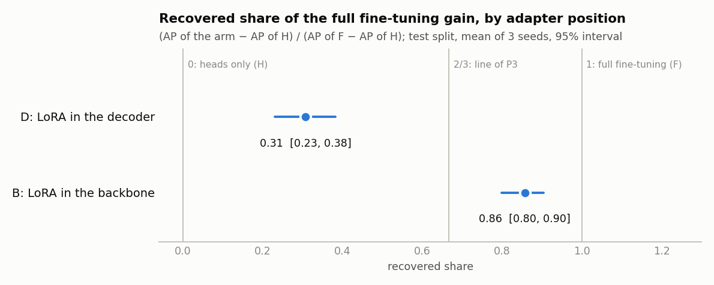

# truckdet

**Where must LoRA go in a detector: the backbone or the decoder?**
A controlled test on truck types in traffic-camera images.

> **Status:** the experiment is finished. The 24 training runs and the test split ran on a Colab T4, and the results are [below](#results) and in [results/report.md](results/report.md): P1 and P3 are confirmed, and P2 is refuted. The split is not a camera split: three methods failed to separate the cameras, so the answer is for test images that have no near image in the training data, not for new cameras (`docs/build_notes.md` §12 and §13). One check is open: a second run of the report must give the same text (`docs/build_notes.md` §18).
> The design is in [docs/design.md](docs/design.md); what the build confirmed and corrected is in
> [docs/build_notes.md](docs/build_notes.md).

## The question

With the same number of adapter parameters, does LoRA recover more of the
full fine-tuning gain in the backbone or in the decoder?

## Where the question comes from

This project follows an earlier project of mine, `detr-lora`.

In that project I adapted a pre-trained DETR (ResNet-50) to four LVIS truck
classes: `truck`, `pickup_truck`, `trailer_truck` and `fire_engine`. I wrote
LoRA from scratch (rank 8, on the attention query and value projections,
mergeable into the base weights) and the DETR set loss with Hungarian
matching. The trainable part was 0.68% of the model.

The project failed in a specific way:

- **The detector found the trucks but gave the wrong label.** It labelled 78%
  of the trailers and 95% of the fire engines as generic `truck`.
- **LoRA did not help measurably.** It added +0.017 AP to heads-only training,
  with a 95% interval of [−0.014, +0.051].
- **Better features did help.** I kept DETR's boxes and let a
  logistic-regression head on frozen CLIP ViT-L/14 features decide the class.
  AP went from 0.40 to 0.52.

My reading was that the features limited the detector, and that my adapters
were in the wrong position. They came after a frozen ResNet-50, where they
could not change the features.

I could not test that reading on that data:

1. LVIS checked most images for one truck type only, so the labels were
   incomplete.
2. The class `truck` contained its subtypes.
3. The validation set had 258 images and 22 fire-engine boxes.

## Why this project

truckdet tests the reading directly.

- **A model with two positions for the same adapter.** RF-DETR has a
  transformer backbone (DINOv2) and a transformer decoder.
- **Data with clean labels.** MIO-TCD has 110,000 labelled traffic-camera
  images and 11 classes that do not contain each other. They include
  `pickup_truck`, `articulated_truck`, `single_unit_truck` and `work_van`.
- **A test split that can show a difference.** It has about 10,000 images,
  against 258 in the earlier project.

The result of this project is the answer to the question, with its
uncertainty. It is not a leaderboard number.

## The experiment

Four training configurations ("arms") start from the same pre-trained model:

| Arm | Trainable | Adapter parameters |
|---|---|---|
| H | Prediction heads only | 0 |
| D | Heads, and LoRA in the decoder (rank 33, 9 projections) | 152,064 |
| B | Heads, and LoRA in the backbone (rank 9, 22 projections) | 152,064 |
| F | All parameters (full fine-tuning) | — |

Trainable parameters, counted on the real checkpoint: H 1,896,146; D and B 2,048,210 each; F 31,886,690.

The *recovered share* of an arm X is (AP_X − AP_H) / (AP_F − AP_H).

I wrote three predictions before any training run:

| | Prediction | Confirmed if |
|---|---|---|
| P1 | LoRA in the backbone is better than LoRA in the decoder. | The 95% interval of AP_B − AP_D is above zero. |
| P2 | The advantage of the backbone is in the labels, not in the boxes. | Label accuracy on the truck classes is higher for B, and the share of localized boxes is not different. |
| P3 | LoRA in the backbone recovers most of the full fine-tuning gain. | The 95% interval of the recovered share of B is above 2/3. |

A gate comes first. If heads-only and full fine-tuning are less than 0.05 AP
apart on the validation split, the data cannot separate the arms, and the
project stops there.

## How the comparison stays fair

- **Equal adapter budget.** Arms B and D have exactly the same number of LoRA
  parameters.
- **No dead adapters.** The detector does not use the last backbone layer, so
  LoRA skips it.
- **A learning rate for each arm,** chosen on the validation split.
- **Three seeds for each arm,** and a paired bootstrap on the scene groups of the
  test split. Frames of one camera are not independent.
- **A split by scene group.** The dataset has no camera ID. A scene group is
  a connected set of images that are linked at or above a similarity limit,
  and each group is in one split. An automatic search sets the limit. The
  test images have no near image in the training data: no training image
  has a similarity of 0.7214 or more to a test image. A random image split
  cannot give that: its test images have near copies in the training data.
- **The cameras are not separated.** A scene group is not a camera. For 60
  of 100 test images, the nearest training-pool image shows the same camera
  in other conditions. So the answer is for images that are different from
  the training images. It is not an answer for new cameras. Three methods
  failed to separate the cameras: at one limit, one group holds many
  cameras, and one camera is in many groups.
- **Ignore regions.** The class `motorized_vehicle` marks vehicles that are
  too small to identify. A detection of one of six vehicle classes on such a
  box is not a true positive and not a false positive. The six classes are
  those of the dataset's own evaluation code.
- **The test split is scored one time** for each final model.

## Results

Test split: 10,001 images in 1,096 scene groups, scored one time for each of
the 12 final models. A number of an arm is the mean of 3 seeds. An interval
is the 95% range of 400 paired bootstrap resamples of the scene groups. The
full report is [results/report.md](results/report.md), and its numbers are in
[results/numbers.json](results/numbers.json).

| | Prediction | Outcome | Evidence (test split, 95% interval) |
|---|---|---|---|
| P1 | LoRA in the backbone is better than LoRA in the decoder. | **confirmed** | AP_B − AP_D = +0.083 [+0.064, +0.099] |
| P2 | The advantage of the backbone is in the labels, not in the boxes. | **refuted** | Truck family, B − D: label accuracy -7.1% [-11.6, -3.2] points; localized share -0.1% [-1.0, +0.9] points |
| P3 | LoRA in the backbone recovers most of the full fine-tuning gain. | **confirmed** | Recovered share of B = 0.857 [0.799, 0.904]; the line is 0.667 |

| Arm | Trainable parameters | AP [95% interval] | AP by seed | Recovered share [95% interval] |
|---|---|---|---|---|
| H: heads only | 1,896,146 | 0.350 [0.325, 0.374] | 0.351 / 0.350 / 0.348 | 0 (by definition) |
| D: LoRA in the decoder | 2,048,210 | 0.397 [0.372, 0.426] | 0.395 / 0.397 / 0.398 | 0.307 [0.230, 0.382] |
| B: LoRA in the backbone | 2,048,210 | 0.480 [0.450, 0.508] | 0.485 / 0.473 / 0.482 | 0.857 [0.799, 0.904] |
| F: full fine-tuning | 31,886,690 | 0.502 [0.472, 0.532] | 0.499 / 0.501 / 0.505 | 1 (by definition) |



**The answer.** With the same 152,064 adapter parameters, LoRA in the
backbone recovers 0.857 of the full fine-tuning gain, and LoRA in the decoder
recovers 0.307. The backbone arm is 0.083 AP above the decoder arm, and the
difference has the same sign in 9 of 9 seed pairs. Full fine-tuning is
0.022 AP [0.014, 0.030] above LoRA in the backbone.

**P2 is refuted, and the report does not show where the advantage is.**

- The two arms find the same share of the boxes. In the truck family, B
  localizes 97.4% of the boxes and D localizes 97.5%.
- Label accuracy is lower for B (39.4%) than for D (46.5%).
- But label accuracy does not follow AP. Full fine-tuning has the highest AP
  of the truck family (0.500) and the lowest label accuracy (34.4%). For 50%
  of the truck-family boxes, its top class is `car`. For 12% of them, the top
  class of B is `motorized_vehicle`.
- The two numbers measure different things. Label accuracy reads one query
  for each box (the candidate with the highest IoU) and only its top class.
  AP ranks the detections of each class separately, so a second class of the
  same query, or a second query at the same box, can be the true positive.
- Box AP (all classes as one class) is 0.637 for B and 0.599 for D.

So the outcome of P2 is for label accuracy as the design defines it. It is
not a measurement of where the AP advantage of the backbone comes from.

**Read the result with its limits.** The cameras are not separated, and the
test images were selected with the features of the frozen backbone. Both are
possibly to the advantage of the backbone arms, so a confirmed P1 is the
weaker result. The list is in [Limits](#limits).

The sample images of the report are not in the repository. They hold dataset
images (CC BY-NC-SA 4.0).

## Run it

The experiment runs on a Colab T4 from one notebook,
[notebooks/colab_train.ipynb](notebooks/colab_train.ipynb). The notebook has one switch, `STAGE`. Each
stage ends with its check from the design, and the next stage does not start before that check passes.
Stages `checks` to `report` read the split of the project from `splits/`.

| `STAGE` | What runs | The check |
|---|---|---|
| `spike` | Model facts on the real checkpoint; speed and memory of each arm | The parameter counts; the last backbone layer changes no logit |
| `data` | Download, converter, scene groups, the split files of the run | Counts, label completeness, class counts, no overlap, group check, split check; the scene measurement is a count for the report |
| `checks` | The COCO checkpoint with no training; the training loop on 16 images | AP50 of `car` and `bus` above zero; arm F reaches AP50 above 0.9 |
| `gate` | Learning-rate runs of H and F | The gate |
| `main` | Learning-rate runs of D and B; seeds 1 and 2 of all arms | No skipped step; the merge check |
| `report` | The test split, one time for each final checkpoint; the report | A second run gives the same text |

On a computer with no GPU:

```bash
uv venv --python 3.12 .venv && uv pip install --python .venv/bin/python -e ".[dev]"
```

```bash
.venv/bin/python -m pytest
```

```bash
.venv/bin/python -m pytest -m slow
```

```bash
.venv/bin/python scripts/spike.py
```

The first command makes the environment. The second runs the tests on a tiny random RF-DETR and a
synthetic dataset (no network, 20 seconds). The third and the fourth check the facts of the design on
the real checkpoint (a download of 130 MB the first time).

## The code

| Unit | Responsibility |
|---|---|
| `data/miotcd.py` | `gt_train.csv` to COCO JSON; counts; class order |
| `data/scenes.py` | Embeddings, scene groups by links, the search for the limit, the split with a cap for each group, the group check and the split check |
| `data/dataset.py` | Dataset and collate function with the library's image processor |
| `model/lora.py` | `LoRALinear`, `inject_lora` with a layer filter, `merge_lora` |
| `model/arms.py` | The start model, the class heads, freezing by name, the adapters of an arm, the parameter table |
| `engine.py`, `training.py`, `checkpoint.py` | The library's loss in float32, optimizer groups, schedule, one epoch, a run that can resume |
| `evaluation.py` | Saved predictions; ignore regions; AP with a weight for each image; box AP |
| `errors.py` | Localized share, label accuracy, confusion table |
| `stats.py` | Paired bootstrap of scene groups, recovered share, the gate, the three readings as text |
| `runs.py`, `report.py`, `plotting.py`, `sheets.py` | Run folders, learning-rate choice, the report, the figure, the check sheets |
| `scripts/` | One script for each step of the notebook; `scene_split_simulation.py` tests the scene groups on invented cameras |

All analysis runs on a CPU from the saved predictions of each run.

## Written by me, and borrowed

| Written by me | Borrowed |
|---|---|
| LoRA layer, injection and merging (from `detr-lora`) | RF-DETR model, weights, loss and image processor (`transformers`) |
| Dataset converter and scene split | Matching of detections to boxes (`pycocotools`) |
| Arm definitions and parameter accounting | Connected sets of a graph (`scipy`) |
| Training loop | PyTorch |
| Evaluation with ignore regions, AP from the matches, error split, bootstrap statistics | |

## Limits

- One model (RF-DETR base) and one dataset. The answer is not a general law.
- Full fine-tuning uses a simple recipe. If it is under-tuned, the recovered
  share of LoRA is too high.
- The cameras are not separated. For 60 of 100 test images, the nearest
  training-pool image shows the same camera (an interval of about 50% to
  69%; it is a lower limit). The answer is not an answer for new cameras.
- The test images were selected with the features of the frozen backbone.
  Arms H and D keep these features; arms B and F change them. This is
  possibly to the advantage of B and F.
- These two limits go in the same direction. A confirmed P1 is the weaker
  result, and a refuted P1 is the stronger result.
- The splits do not have the composition of the dataset. A scene group
  gives at most 300 images to the test split and at most 100 to the val
  split. 22 groups at the cap give 6,600 of the 10,001 test images, and the
  val split is different from the test split.
- One rule set the limit of 0.7214: the largest group has at most 20% of
  the images. No other limit was tried.
- Some objects have no box: 2.0% of the clear objects, and about 10.5% with
  the objects that a person can only guess (tiny, occluded or blurred
  vehicles, and lights at night). A detection on such an object is a false
  positive, for each arm.
- Equal parameter counts are not equal capacity. Rank 33 is a larger share of
  a decoder matrix than rank 9 is of a backbone matrix.

## Data and licence

MIO-TCD is available from tcd.miovision.com under CC BY-NC-SA 4.0. This
repository contains code and lists of image IDs. It contains no images.