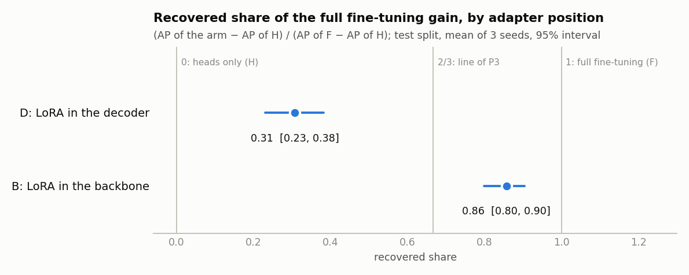
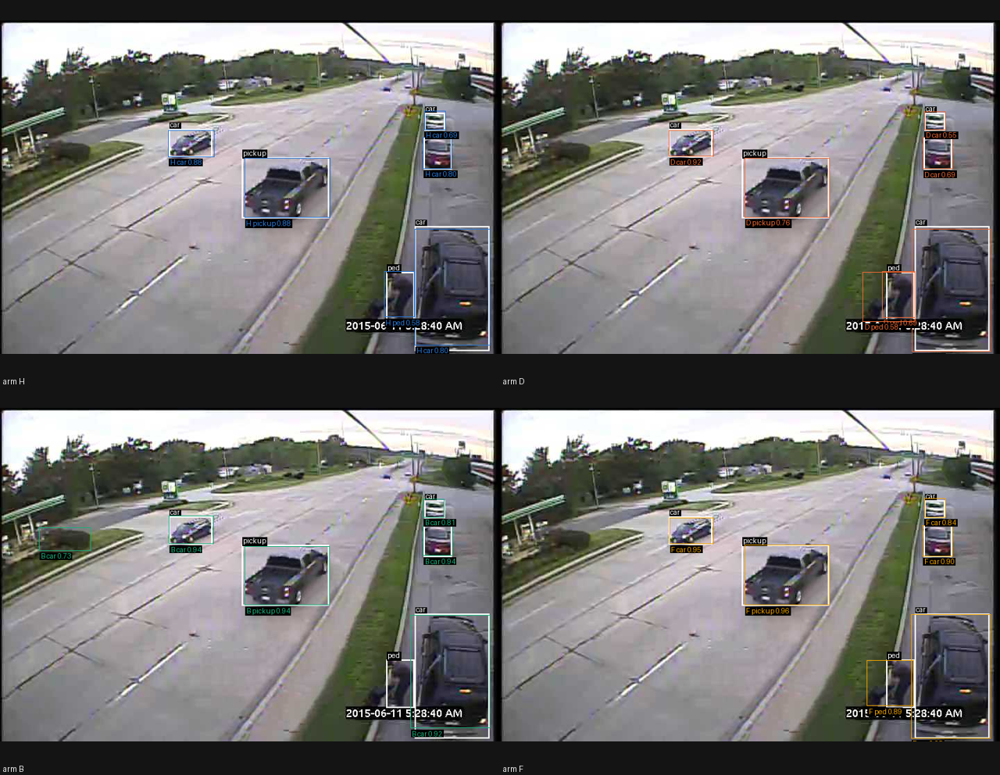
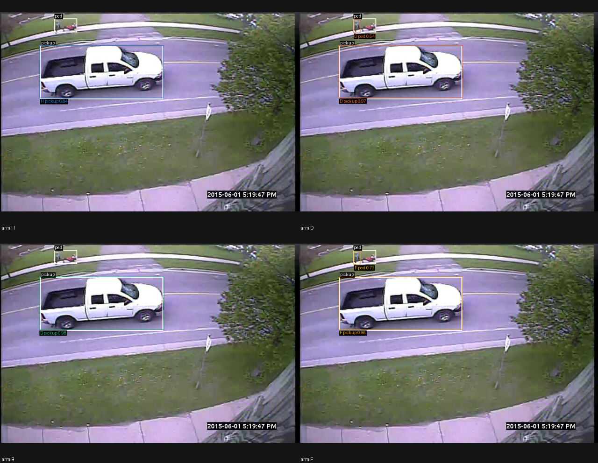
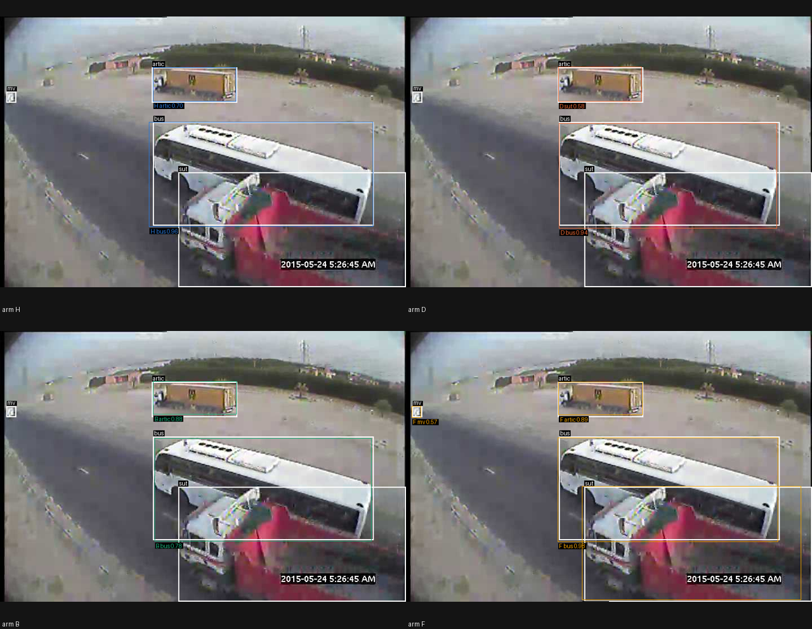
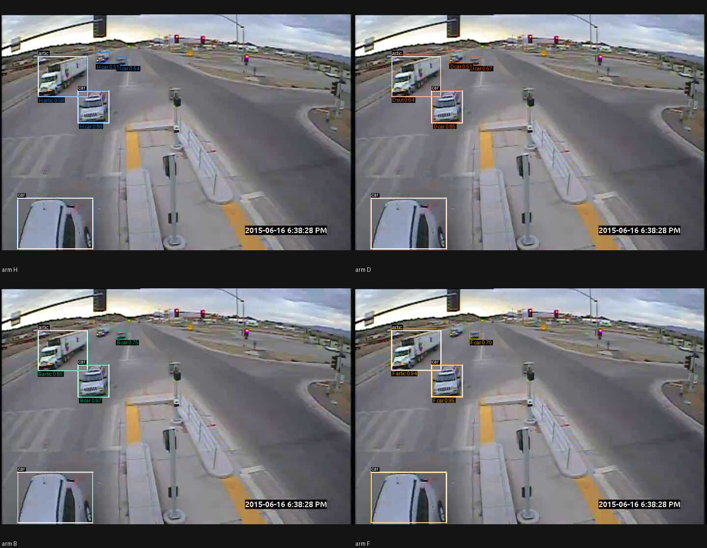
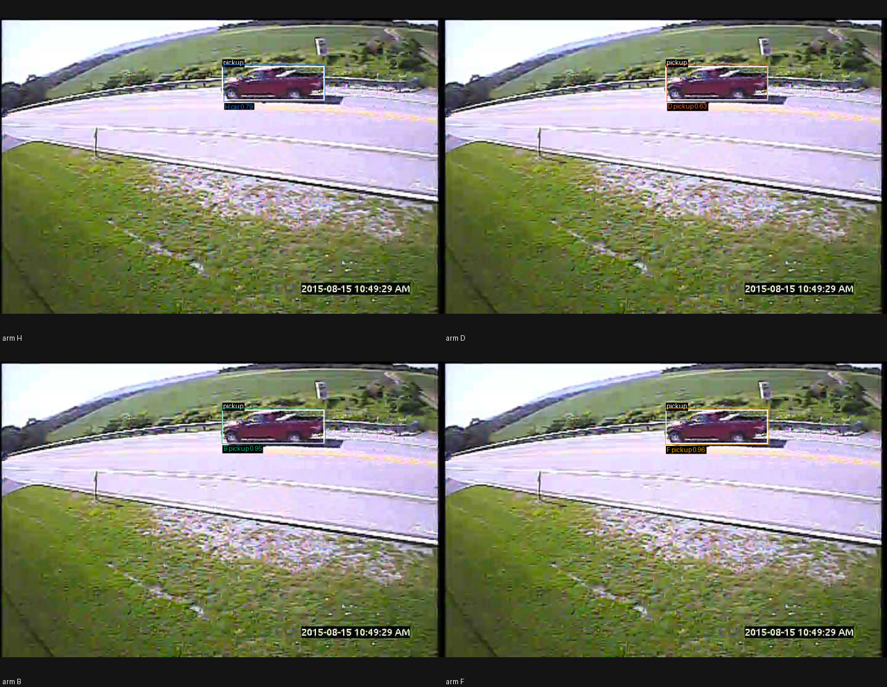
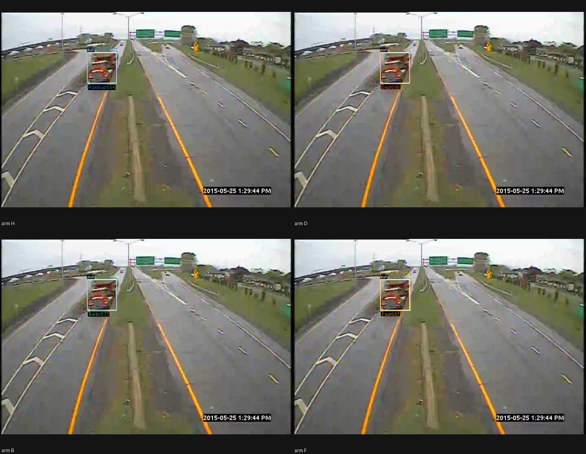
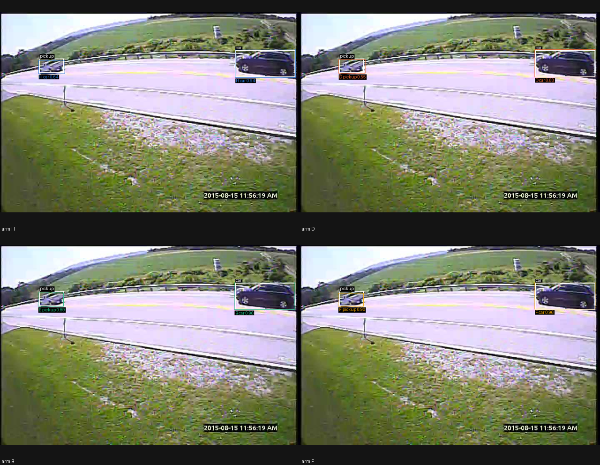
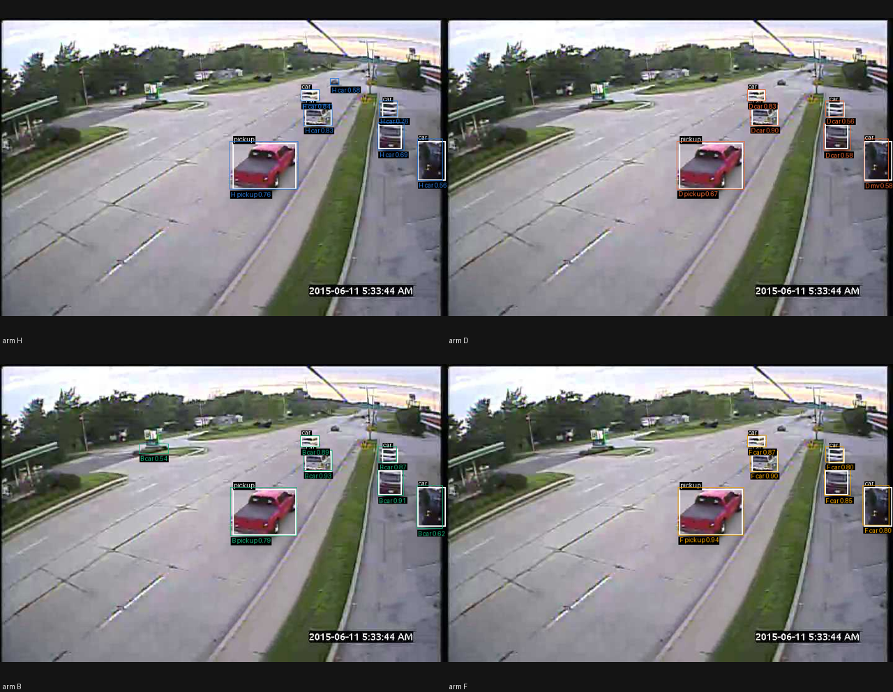

# LoRA position in RF-DETR: backbone against decoder, on MIO-TCD — results

**Question.** With the same number of adapter parameters, does LoRA recover more of the full fine-tuning gain in the backbone or in the decoder?

**Predictions and outcomes.** The predictions were written before any training run. An outcome is "confirmed", "refuted" or "not shown".

| | Prediction | Outcome | Evidence (test split, 95% interval) |
|---|---|---|---|
| P1 | LoRA in the backbone is better than LoRA in the decoder. | **confirmed** | AP_B − AP_D = +0.083 [+0.064, +0.099] |
| P2 | The advantage of the backbone is in the labels, not in the boxes. | **refuted** | Truck family, B − D: label accuracy -7.1% [-11.6, -3.2] points; localized share -0.1% [-1.0, +0.9] points |
| P3 | LoRA in the backbone recovers most of the full fine-tuning gain. | **confirmed** | Recovered share of B = 0.857 [0.799, 0.904]; the line is 0.667 |

Recovered share of an arm X: (AP_X − AP_H) / (AP_F − AP_H). Decoder: 0.307 [0.230, 0.382]. Backbone: 0.857 [0.799, 0.904].

*The scope of the answer.* The test images have no near image in the training data: no training image has a similarity of 0.7214 or more to a test image. The cameras are not separated. For 60 of 100 test images that a person looked at, the nearest training-pool image shows the same camera in other conditions. So the answer is for images that are different from the training images. It is not an answer for new cameras.

*How to read the numbers.* Test split, 10,001 images. A number of an arm is the mean of 3 seeds (0, 1, 2). An interval is the 2.5% to 97.5% range of 400 paired bootstrap resamples of the 1,096 scene groups of the split: frames of one camera are not independent, so a resample draws whole groups. All arms and seeds are scored on the same resample, and the seeds of an arm are averaged. AP is COCO AP (IoU 0.50 to 0.95) as the mean of the 10 specific classes, from the 100 best (query, class) pairs of each image. A detection of `articulated_truck`, `bus`, `car`, `pickup_truck`, `single_unit_truck`, `work_van` on a `motorized_vehicle` box is not a true positive and not a false positive.

## Results

| Arm | Trainable parameters | AP [95% interval] | AP by seed | Recovered share [95% interval] |
|---|---|---|---|---|
| H: heads only | 1,896,146 | 0.350 [0.325, 0.374] | 0.351 / 0.350 / 0.348 | 0 (by definition) |
| D: LoRA in the decoder | 2,048,210 | 0.397 [0.372, 0.426] | 0.395 / 0.397 / 0.398 | 0.307 [0.230, 0.382] |
| B: LoRA in the backbone | 2,048,210 | 0.480 [0.450, 0.508] | 0.485 / 0.473 / 0.482 | 0.857 [0.799, 0.904] |
| F: full fine-tuning | 31,886,690 | 0.502 [0.472, 0.532] | 0.499 / 0.501 / 0.505 | 1 (by definition) |

### Differences in AP

| Difference | Value [95% interval] | Seed pairs that agree in sign with it |
|---|---|---|
| B − D | +0.083 [+0.064, +0.099] | 9 of 9 |
| D − H | +0.047 [+0.032, +0.062] | 9 of 9 |
| B − H | +0.130 [+0.104, +0.155] | 9 of 9 |
| F − H | +0.152 [+0.124, +0.178] | 9 of 9 |
| F − B | +0.022 [+0.014, +0.030] | 9 of 9 |

*The unit of the bootstrap.* AP_B − AP_D with resamples of scene groups: +0.083 [+0.064, +0.099]. With resamples of single images: +0.083 [+0.077, +0.090]. Frames of one camera are not independent, so the image interval is too narrow. All other intervals and all readings of this report use the scene groups.

## Error split: boxes and labels

Candidates: the 50 queries of an image with the highest class score. A ground-truth box is localized if a candidate has IoU ≥ 0.5 with it; the candidate with the highest IoU is its representative query. Label accuracy: of the localized boxes, the share whose representative query has the correct top class. Box AP: AP with all classes merged into one, one detection per query.

### Specific classes

| Arm | Localized share [95% interval] | Label accuracy [95% interval] | Box AP |
|---|---|---|---|
| H: heads only | 96.6% [95.4, 97.8] | 72.3% [69.0, 75.7] | 0.577 |
| D: LoRA in the decoder | 96.9% [95.7, 98.0] | 76.9% [73.7, 80.3] | 0.599 |
| B: LoRA in the backbone | 97.3% [96.3, 98.2] | 67.2% [63.3, 71.0] | 0.637 |
| F: full fine-tuning | 97.4% [96.5, 98.3] | 83.0% [79.8, 85.7] | 0.656 |
| B − D (points) | +0.4% [+0.1, +0.9] | -9.7% [-12.5, -7.4] | |

### Truck family

| Arm | Localized share [95% interval] | Label accuracy [95% interval] |
|---|---|---|
| H: heads only | 97.7% [96.6, 98.6] | 34.9% [29.2, 39.5] |
| D: LoRA in the decoder | 97.5% [95.8, 98.7] | 46.5% [43.3, 49.8] |
| B: LoRA in the backbone | 97.4% [96.2, 98.4] | 39.4% [36.1, 42.6] |
| F: full fine-tuning | 97.2% [95.7, 98.6] | 34.4% [31.8, 37.3] |
| B − D (points) | -0.1% [-1.0, +0.9] | -7.1% [-11.6, -3.2] |

Box AP has all 11 classes as one class, `motorized_vehicle` boxes included.

### Confusion of the truck family, H: heads only

Ground-truth box → top class of its representative query; share of the class's boxes, pooled over 3 seeds.

| Ground truth \ label | articulated_truck | bicycle | bus | car | motorcycle | motorized_vehicle | non-motorized_vehicle | pedestrian | pickup_truck | single_unit_truck | work_van | not localized | Boxes per seed |
|---|---|---|---|---|---|---|---|---|---|---|---|---|---|
| articulated_truck | 55% | 0% | 6% | 19% | 0% | 1% | 1% | 0% | 7% | 5% | 1% | 4% | 891 |
| pickup_truck | 2% | 0% | 1% | 48% | 0% | 2% | 0% | 0% | 43% | 1% | 1% | 1% | 2220 |
| single_unit_truck | 34% | 0% | 6% | 31% | 0% | 3% | 1% | 0% | 14% | 7% | 2% | 2% | 816 |
| work_van | 2% | 0% | 6% | 51% | 0% | 2% | 0% | 0% | 14% | 3% | 18% | 3% | 1015 |

### Confusion of the truck family, D: LoRA in the decoder

Ground-truth box → top class of its representative query; share of the class's boxes, pooled over 3 seeds.

| Ground truth \ label | articulated_truck | bicycle | bus | car | motorcycle | motorized_vehicle | non-motorized_vehicle | pedestrian | pickup_truck | single_unit_truck | work_van | not localized | Boxes per seed |
|---|---|---|---|---|---|---|---|---|---|---|---|---|---|
| articulated_truck | 58% | 0% | 6% | 4% | 0% | 4% | 3% | 0% | 2% | 17% | 2% | 4% | 891 |
| pickup_truck | 1% | 0% | 0% | 43% | 0% | 3% | 1% | 0% | 48% | 0% | 1% | 2% | 2220 |
| single_unit_truck | 21% | 0% | 5% | 15% | 0% | 5% | 6% | 0% | 7% | 35% | 5% | 2% | 816 |
| work_van | 1% | 0% | 4% | 41% | 0% | 3% | 2% | 0% | 7% | 3% | 37% | 4% | 1015 |

### Confusion of the truck family, B: LoRA in the backbone

Ground-truth box → top class of its representative query; share of the class's boxes, pooled over 3 seeds.

| Ground truth \ label | articulated_truck | bicycle | bus | car | motorcycle | motorized_vehicle | non-motorized_vehicle | pedestrian | pickup_truck | single_unit_truck | work_van | not localized | Boxes per seed |
|---|---|---|---|---|---|---|---|---|---|---|---|---|---|
| articulated_truck | 59% | 0% | 5% | 8% | 0% | 12% | 4% | 0% | 0% | 8% | 0% | 3% | 891 |
| pickup_truck | 0% | 0% | 0% | 39% | 0% | 9% | 4% | 0% | 41% | 6% | 0% | 1% | 2220 |
| single_unit_truck | 29% | 0% | 4% | 10% | 0% | 18% | 9% | 0% | 4% | 21% | 2% | 4% | 816 |
| work_van | 0% | 0% | 1% | 25% | 0% | 17% | 1% | 0% | 4% | 20% | 28% | 4% | 1015 |

### Confusion of the truck family, F: full fine-tuning

Ground-truth box → top class of its representative query; share of the class's boxes, pooled over 3 seeds.

| Ground truth \ label | articulated_truck | bicycle | bus | car | motorcycle | motorized_vehicle | non-motorized_vehicle | pedestrian | pickup_truck | single_unit_truck | work_van | not localized | Boxes per seed |
|---|---|---|---|---|---|---|---|---|---|---|---|---|---|
| articulated_truck | 53% | 0% | 4% | 26% | 0% | 6% | 2% | 0% | 1% | 4% | 0% | 4% | 891 |
| pickup_truck | 0% | 0% | 0% | 61% | 0% | 2% | 1% | 0% | 34% | 0% | 0% | 1% | 2220 |
| single_unit_truck | 22% | 0% | 3% | 38% | 0% | 8% | 6% | 0% | 2% | 14% | 1% | 5% | 816 |
| work_van | 0% | 0% | 1% | 56% | 0% | 5% | 1% | 0% | 2% | 2% | 30% | 3% | 1015 |

## Other metrics

| Metric | H: heads only | D: LoRA in the decoder | B: LoRA in the backbone | F: full fine-tuning |
|---|---|---|---|---|
| AP50 | 0.474 [0.444, 0.506] | 0.540 [0.512, 0.572] | 0.643 [0.610, 0.674] | 0.667 [0.633, 0.697] |
| AP75 | 0.387 [0.357, 0.418] | 0.439 [0.408, 0.474] | 0.532 [0.494, 0.571] | 0.556 [0.517, 0.596] |
| AP small | 0.112 | 0.115 | 0.170 | 0.176 |
| AP truck family | 0.308 [0.267, 0.339] | 0.370 [0.326, 0.418] | 0.469 [0.416, 0.510] | 0.500 [0.454, 0.541] |
| AP motorized_vehicle | 0.102 | 0.194 | 0.207 | 0.214 |
| AP 11 classes, no ignore regions | 0.325 | 0.376 | 0.451 | 0.471 |
| box AP | 0.577 | 0.599 | 0.637 | 0.656 |
| box AP50 | 0.827 | 0.857 | 0.885 | 0.900 |

AP of each specific class:

| Class | H: heads only | D: LoRA in the decoder | B: LoRA in the backbone | F: full fine-tuning |
|---|---|---|---|---|
| articulated_truck | 0.342 [0.192, 0.499] | 0.438 [0.358, 0.535] | 0.552 [0.456, 0.640] | 0.598 [0.490, 0.692] |
| bicycle | 0.328 [0.267, 0.427] | 0.415 [0.353, 0.542] | 0.487 [0.401, 0.603] | 0.515 [0.427, 0.630] |
| bus | 0.819 [0.757, 0.859] | 0.850 [0.800, 0.882] | 0.899 [0.871, 0.918] | 0.909 [0.886, 0.925] |
| car | 0.556 [0.495, 0.609] | 0.579 [0.517, 0.630] | 0.615 [0.557, 0.667] | 0.637 [0.581, 0.687] |
| motorcycle | 0.296 [0.169, 0.420] | 0.367 [0.277, 0.441] | 0.507 [0.427, 0.576] | 0.508 [0.420, 0.576] |
| non-motorized_vehicle | 0.077 [0.047, 0.113] | 0.061 [0.035, 0.091] | 0.125 [0.093, 0.170] | 0.130 [0.090, 0.181] |
| pedestrian | 0.195 [0.144, 0.258] | 0.215 [0.158, 0.279] | 0.290 [0.210, 0.392] | 0.320 [0.237, 0.411] |
| pickup_truck | 0.385 [0.325, 0.430] | 0.472 [0.410, 0.536] | 0.550 [0.493, 0.624] | 0.564 [0.498, 0.638] |
| single_unit_truck | 0.210 [0.081, 0.393] | 0.223 [0.098, 0.409] | 0.314 [0.156, 0.444] | 0.326 [0.196, 0.445] |
| work_van | 0.293 [0.215, 0.377] | 0.345 [0.267, 0.429] | 0.460 [0.372, 0.548] | 0.511 [0.426, 0.594] |

## Learning rates and the gate (val split, seed 0)

| Arm | Chosen rate | Val AP of each rate tried |
|---|---|---|
| H: heads only | 0.001 | 0.0001: 0.315, 0.0003: 0.339, 0.001: 0.350, 0.003: 0.349 |
| D: LoRA in the decoder | 0.001 | 0.0001: 0.355, 0.0003: 0.389, 0.001: 0.408, 0.003: 0.408 |
| B: LoRA in the backbone | 0.001 | 0.0001: 0.454, 0.0003: 0.486, 0.001: 0.494, 0.003: 0.440 |
| F: full fine-tuning | body 1e-05, heads 0.001 | 0.0001: 0.384, 1e-05: 0.521, 3e-05: 0.501, 3e-06: 0.509 |

AP_F − AP_H on the val split (seed 0) = +0.172 (AP_H 0.350, AP_F 0.521); bootstrap standard error 0.0143 (resamples of the 513 scene groups); the difference is 12.0 times its standard error. Needed: at least 0.05 AP and at least 5 times the standard error. The gate passes: continue with the main runs.

## Checks

| Arm | Runs | Merge difference (largest) | Skipped batches | Steps the fp16 scaler skipped |
|---|---|---|---|---|
| H: heads only | h_lr1e-3_s0, h_lr1e-3_s1, h_lr1e-3_s2 | 0.0e+00 | 0 | 12 |
| D: LoRA in the decoder | d_lr1e-3_s0, d_lr1e-3_s1, d_lr1e-3_s2 | 4.0e-14 | 0 | 12 |
| B: LoRA in the backbone | b_lr1e-3_s0, b_lr1e-3_s1, b_lr1e-3_s2 | 1.1e-13 | 0 | 18 |
| F: full fine-tuning | f_lr1e-5_h1e-3_s0, f_lr1e-5_h1e-3_s1, f_lr1e-5_h1e-3_s2 | 0.0e+00 | 0 | 29 |

A skipped batch had a loss that was not finite. A step that the fp16 scaler skipped had a scaled gradient that was not finite; the scaler halves its scale and the run goes on.

## Sample images

White: ground truth. Colour: detections with a score of 0.5 or more, by arm (seed 0).

## Limits

- **One model and one dataset.** The answer is for RF-DETR-base on traffic-camera images. It is not a general law.
- **Full fine-tuning uses a simple recipe** (no weight averaging, no layer-wise learning-rate decay). If AP_F is low for that reason, the recovered shares are too high.
- **Equal counts are not equal capacity.** Rank 33 is 13% of the full rank of a decoder matrix; rank 9 is 2% of a backbone matrix. This is to the advantage of the decoder.
- **The cameras are not separated.** The test images have no near image in the training data: no training image has a similarity of 0.7214 or more to a test image. For 60 of 100 test images that a person looked at, the nearest training-pool image shows the same camera in other conditions. The count has a 95% interval of 50% to 69% (100 pairs). It is a lower limit: a camera can be in the train pool and not be the nearest image. In a random image split the count was 50 of 50. So the answer is for images that are different from the training images. It is not an answer for new cameras.
- **The test images were selected with the features of the frozen backbone.** They are far from the training images in those features. Arms H and D keep these features; arms B and F change them. This is possibly to the advantage of B and F.
- **Two limits go in the same direction.** The shared cameras and the selection are both possibly to the advantage of the backbone arms. So a confirmed P1 is the weaker result, and a refuted P1 is the stronger result. The limit of the ranks ("Equal counts are not equal capacity") goes in the opposite direction.
- **The splits do not have the composition of the dataset.** The cause is the caps and the sizes of the scene groups. A group gives at most 300 images to the test split and at most 100 to the val split, so a group with many images has no more weight in the test split than a group at the cap. The train subset keeps the weights of the train pool.

  | Share of the images that come from | Dataset | Train subset | Test | Val |
  |---|---|---|---|---|
  | groups with fewer than 100 images | 6.4% | 5.1% | 23.2% | 65.3% |
  | groups with 1,000 images or more | 74.2% | 78.4% | 33.0% | 19.8% |

- **The val split is different from the test split.** The val cap of 100 is the cause. The learning-rate choice and the gate use the val split.
- **A few groups give most of the test split.** 22 groups are at the cap of 300 and give 6,600 of the 10,001 images. One group can hold more than one camera: 50 images of the largest group show 5 cameras.
- **The limit is the result of one rule.** The search for the limit stops when the largest group has more than 20% of the images, and this rule set 0.7214. The 20% is a choice. No other limit was tried.
- **Some objects have no box.** On 100 random images with 297 boxes, a person found 6 clear objects with no box: 2.0% of the clear objects (the limit of the label check is 5%). A clear object is fully visible, and it moves or is on the road. With the objects that a person can only guess (tiny, occluded or blurred vehicles, and lights at night), about 35 objects have no box: about 10.5%. A detection on an object with no box is a false positive, for each arm.
- **The intervals show the dependence on the scene groups of the test split.** They do not show the variance between seeds; the tables give the 3 seed values and the seed pairs for that.
- **Not a leaderboard number.** The public MIO-TCD leaderboard uses another split, all the training data and another protocol. Its numbers and these numbers are not a comparison.
- **The library port.** Numbers can be different from those of the original `rfdetr` package.
